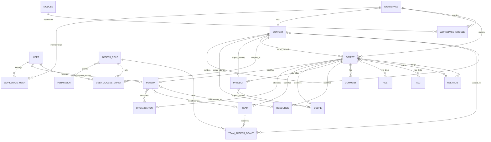

# ERD — Core V1

## Invariants structurants

1. `workspace_id` est conservé sur les tables métier même lorsqu'il est déductible.
2. Les FK transversales workspace-scoped doivent utiliser des clés composites `(workspace_id, id)` lorsque cela empêche une référence cross-workspace.
3. Un Workspace possède exactement un Context racine de type `workspace`.
4. `contexts.parent_context_id` est l'unique hiérarchie officielle ; `Scope` ne possède pas une seconde hiérarchie parallèle.
5. Un `Project` peut avoir un Scope principal via son Context et plusieurs liens supplémentaires via `project_scopes`.
6. `User` représente l'identité/authentification ; `Person` représente la personne métier dans un Workspace.
7. Une Person n'est une Resource que si elle doit être planifiable/réservable.
8. Les permissions sont contextuelles et héritent dans l'arbre des Contexts.
9. Les objets métier sont archivés par défaut plutôt que supprimés en cascade.

## Tables Core attendues

- `workspaces`
- `users`
- `workspace_users`
- `contexts`
- `objects`
- `persons`
- `organizations`
- `person_organization_links`
- `teams`
- `team_members`
- `job_roles`
- `scopes`
- `projects`
- `project_scopes`
- `resources`
- `permissions`
- `access_roles`
- `access_role_permissions`
- `user_access_grants`
- `team_access_grants`
- `modules`
- `workspace_modules`
- `relations`
- `comments`
- `files`
- `file_links`
- `tags`
- `tag_links`
- `activities`
- `notifications`
- `outbox_events`

`resource_bookings` et `resource_allocations` sont architecturés mais différés après la V1 initiale.