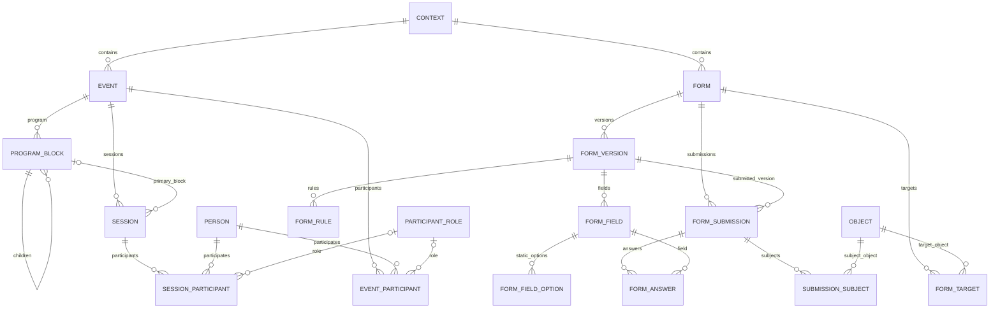

# ERD — Event & Forms V1

## Event — règles

- Event appartient à un Context mais n'est pas lui-même un Context.
- Session appartient obligatoirement à un Event.
- ProgramBlock appartient obligatoirement à un Event.
- Si une Session référence un ProgramBlock, les deux appartiennent au même Event.
- Un ProgramBlock enfant appartient au même Event que son parent.
- Event peut être sans dates lorsqu'il est encore TBD ; une Session possède des dates concrètes en V1.
- `declared_capacity` est une capacité déclarée et non une capacité opérationnelle calculée.
- Participant représente un rôle métier et ne remplace pas Registration.
- Registration, waiting list, ticketing et check-in sont hors V1.

## Forms — règles

- Form vit dans un Context mais peut cibler n'importe quel Object autorisé du Workspace.
- `UNIQUE(form_id, version_number)`.
- Une version publiée est immutable.
- `UNIQUE(form_version_id, key)` pour les champs.
- Les règles V1 restent simples : une condition → une action show/hide (et éventuellement require/optional si retenu lors de l'implémentation).
- Une Submission référence explicitement le Form et la FormVersion utilisée.
- Une Submission `submitted` et ses Answers deviennent immuables.
- `UNIQUE(submission_id, field_id)` ; un multi-select stocke plusieurs valeurs dans le JSON de la réponse.
- Les Subjects d'une Submission sont N:N vers Object Registry.
- Forms conserve la déclaration historique originale ; il ne devient pas la source de vérité des objets métier mis à jour via Automation/Actions.

## V1 réduit

Les champs `reference` dynamiques et les Provider-backed options sont différés en V1.1. Le modèle Object Registry permet de les ajouter sans refonte.