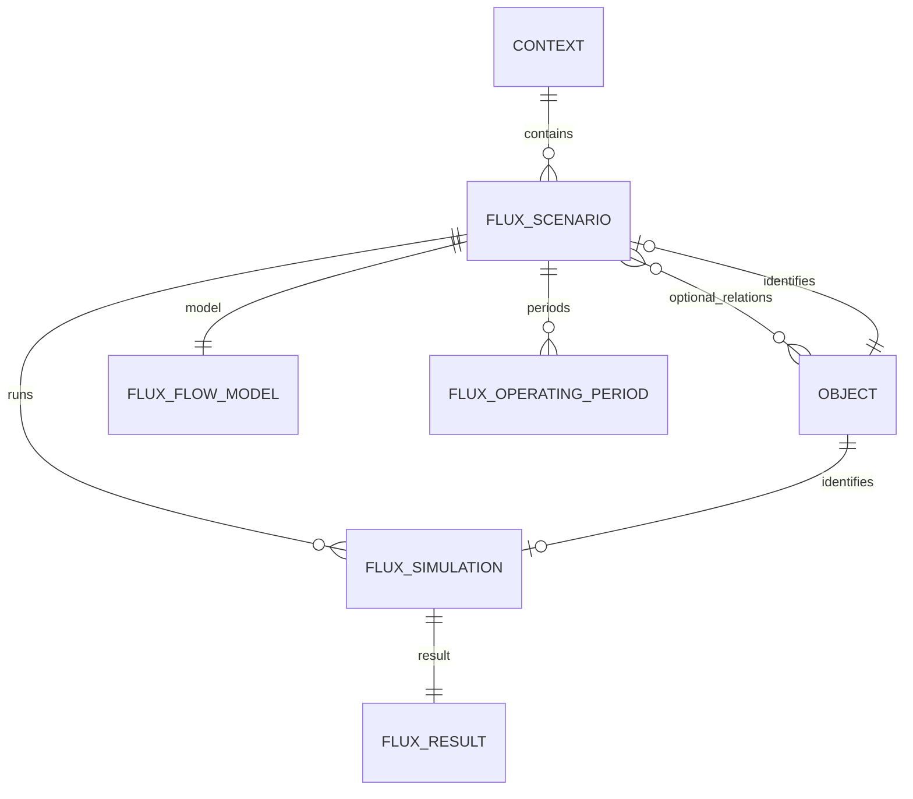

# ERD — Flux Lite V1

## FluxScenario

Objet principal de configuration et de comparaison. Il vit dans un Context et peut être relié facultativement à un Event, une Session, un Project ou un autre Object via les relations génériques.

Modes V1 :

- `session`
- `freeflow`

## Session model

Paramètres JSON attendus :

- `experience_duration_minutes > 0`
- `cycle_duration_minutes > 0`
- `unit_capacity > 0`
- `unit_count > 0`
- `unit_stagger_minutes >= 0`

`cycle_duration` n'est pas contraint à être supérieur ou égal à `experience_duration` : des pipelines/chevauchements peuvent être valides.

## Freeflow model

Paramètres JSON attendus :

- `experience_duration_minutes > 0`
- `entry_interval_minutes > 0`
- `entry_group_size > 0`
- `simultaneous_capacity > 0`

Le moteur compare notamment la cadence d'entrée et la capacité simultanée pour identifier le bottleneck.

## Operating periods

Chaque période impose :

- `start_at < end_at`
- `0 <= demand_fill_rate <= 1`
- absence de chevauchement au sein d'un même scénario, validée par le service Flux.

## Simulation reproductible

Une Simulation snapshotte :

- tous les inputs utilisés ;
- les éventuelles données importées de Providers ;
- la version du moteur (`engine_version`).

Une Simulation terminée et son Result sont immuables. Modifier le Scenario puis relancer crée un nouveau run sans réécrire l'historique.

## Résultats V1

- débit théorique ;
- débit attendu selon le `demand_fill_rate` ;
- capacité totale théorique ;
- visiteurs attendus ;
- maximum simultané ;
- bottleneck basique ;
- timeline de simulation ;
- comparaison de plusieurs simulations/scénarios dans l'UI sans table de comparaison dédiée.

## Modularité

Flux Lite fonctionne entièrement en saisie manuelle. Event, Scheduling, Resources, Spaces ou Workflow pourront plus tard enrichir les inputs via Providers. Flux ne lit jamais directement leurs tables et ne réécrit pas leurs capacités comme vérité métier.