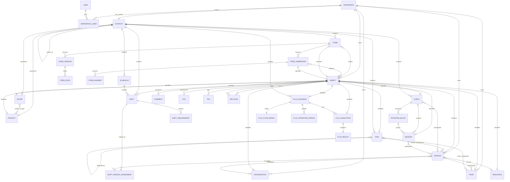

# ERD global simplifié — V1

Ce diagramme présente les frontières de domaines et les relations structurantes. Il ne cherche volontairement pas à afficher toutes les colonnes ni toutes les tables de liaison.

## Lecture

- **Workspace** est la frontière de tenant.
- **Context** définit où vit une activité : Workspace, Scope ou Project.
- **Object Registry** donne une identité générique aux objets qui doivent être référencés transversalement.
- Les relations structurelles internes restent des FK de domaine : Session → Event, Shift → Schedule, Answer → Submission, etc.
- Les liens optionnels entre domaines utilisent `relations` / `object_id`, et les demandes de données dynamiques passent par Providers.
- Aucun module V1 ne doit lire directement les tables privées d'un autre module.
- `Person ↔ Resource` est optionnel en V1 ; Scheduling affecte directement des Persons.

## Domaines V1

| Domaine | Objets principaux |
|---|---|
| Core | Workspace, User, Person, Organization, Team, Scope, Project, Context, Object |
| Core services | Resource, Relation, Comment, File, Tag, Activity, Notification |
| Tasks | Task, Phase, Milestone |
| Scheduling | Schedule, Shift, ShiftRequirement, ShiftPersonAssignment, Availability |
| Event | Event, ProgramBlock, Session, Participant |
| Forms | Form, FormVersion, FormField, FormSubmission, FormAnswer |
| Flux Lite | FluxScenario, FlowModel, OperatingPeriod, Simulation, Result |

Les diagrammes détaillés complètent ce document avec les tables de liaison, cardinalités et invariants.
