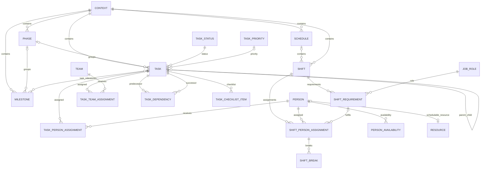

# ERD — Tasks & Scheduling V1

## Tasks — invariants

- Parent et enfant doivent appartenir au même Context.
- Task et Phase doivent appartenir au même Context.
- Milestone et Phase doivent appartenir au même Context.
- Les dépendances entre Tasks peuvent traverser les Contexts, sous réserve des permissions.
- Une Task ne peut dépendre d'elle-même.
- Les cycles de dépendances sont refusés par le service Tasks.
- `estimated_minutes` représente un effort de travail, pas une durée calendaire.
- La récurrence n'est pas implémentée dans Tasks.

## Scheduling — invariants

- Un Shift rattaché à un Schedule partage son Context.
- `start_at < end_at` pour Schedule, Shift, Break et Availability.
- `required_count > 0`.
- Une Person ne possède qu'une affectation par Shift.
- Un `shift_requirement_id` référencé par une affectation doit appartenir au même Shift.
- Les conflits de Shift sont détectés par le service Scheduling et peuvent être avertis ou bloqués selon la politique ; ils ne sont pas globalement interdits par la DB.
- Une pause planifiée appartient à une affectation individuelle, pas au Shift entier.
- Scheduling fonctionne sans module HR.

## Périmètre V1

Inclus : List/Kanban/Calendar, Gantt simple, shifts, requirements, affectations, pauses, disponibilités et détection de conflits.

Différé : templates, récurrence native, workload avancé, auto-scheduling, shift bidding/swapping, time tracking, payroll et matching avancé par compétences.